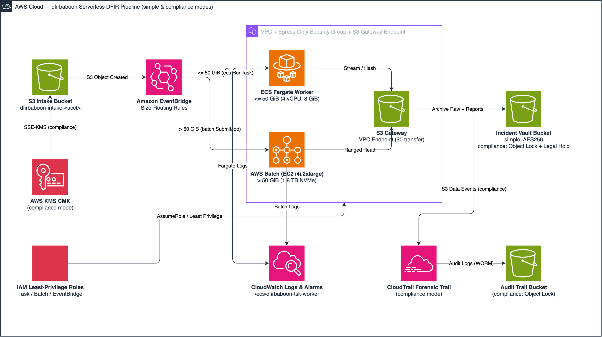

<h1 align="center">dfirbaboon</h1>
<p align="center"><b>Cloud-native, serverless Digital Forensics &amp; Incident Response (DFIR) pipeline on AWS</b></p>

<p align="center">
  <a href="https://github.com/awfullyniceguy/dfirbaboon/blob/main/LICENSE">
    
  </a>
  <a href="https://github.com/awfullyniceguy/dfirbaboon/actions/workflows/ci.yml">
    
  </a>
  
  
  
</p>

---

**dfirbaboon** is an event-driven, serverless forensic processing pipeline built on AWS (S3, EventBridge, ECS Fargate, AWS Batch on EC2, ECR, and KMS). Upload any disk image (`.raw`, `.dd`, `.E01`, `.aff`) or standalone artifact (`.evtx`, `.pf`, `.lnk`, binaries) under an incident prefix (`INCXXXXX/<filename>`) to automatically hash, preserve, carve, scan, and export token-safe Markdown reports.

* **Two Deployment Modes:** Defaults to **`simple` mode** for rapid PoC testing and one-command teardown (`make teardown`); switch to **`compliance` mode** (`FORENSIC_MODE=compliance`) for S3 Object Lock (`COMPLIANCE`), S3 Legal Hold, KMS CMK encryption, `GLACIER_IR` archival, and CloudTrail S3 data-event auditing.
* **Dual-Tier Serverless Compute:** Routes objects **≤ 50 GiB** to **ECS Fargate** and objects **> 50 GiB** to **AWS Batch on EC2** (`i4i.2xlarge` with 1.8 TB local NVMe SSD) over a private S3 Gateway Endpoint.
* **Parallel Forensic Analysis:** Streams 16 MiB chunks for dual `SHA-256`/`MD5` hashing and acquisition verification, then runs **The Sleuth Kit (TSK)**, **unallocated carving (`blkls` + PhotoRec)**, and **YARA** scanning with MITRE ATT&CK tagging.
* **AI & Obsidian Ready:** Exports bounded, YAML-frontmattered Markdown reports (`[[WikiLinks]]`, FRE 1006 disclaimers) alongside CSV supertimelines and JSON Chain of Custody manifests.
* **Enterprise BYO Support:** Works out-of-the-box or in **Bring-Your-Own (BYO)** mode with pre-vended KMS keys, S3 evidence lakes, IAM permissions boundaries, and private VPCs.

---

## Architecture

<p align="center">
  
</p>

> Editable source: [`docs/architecture.drawio`](docs/architecture.drawio) (generated via `aws-drawio`).

<details>
<summary>Detailed Pipeline Flow &amp; Vault Layout (<code>simple</code> Mode — Default)</summary>

```text
+---------------------------------------------------------------------------------------------------------------------------------+
|                                          AWS Cloud (Serverless DFIR — simple Mode)                                              |
|                                                                                                                                 |
|  +-------------------------------+             S3 Object Created               +---------------------------------------------+  |
|  |       S3 Intake Bucket        | ------------------------------------------> |             Amazon EventBridge              |  |
|  | dfirbaboon-intake-<acct_id>   |      s3://.../INC10492/server.raw           |          dfirbaboon-evidence-drop           |  |
|  | (Lifecycle Expire, AES256,    |                                             +----------------------+----------------------+  |
|  |  force_destroy = true)        |                                                                    |                         |
|  +---------------+---------------+                                      Size <= 50 GiB                | Size > 50 GiB           |
|                  | (Private via S3 Gateway Endpoint - $0 Data Transfer) +-----------------------------+-------------------------+
|                  |                                                      |                                                       |
|                  |                                                      v ecs:RunTask                           v batch:SubmitJob
|                  |                                        +---------------------------+           +-----------------------------+
|                  |                                        |    ECS Fargate Worker     |           |    AWS Batch (EC2 Worker)   |
|                  +--------------------------------------> |   dfirbaboon-tsk-worker   |           |  dfirbaboon-tsk-worker-large|
|                  |                                        |  4 vCPU | 8 GiB RAM       |           |  i4i.2xlarge (8 vCPU, 64GB) |
|                  |                                        |  100 GiB Ephemeral Disk   |           |  1.8 TB Local NVMe SSD      |
|                  |                                        |  Evidence <= 50 GiB       |           |  Evidence 50 GiB - 1+ TB    |
|                  |                                        +-------------+-------------+           +--------------+--------------+
|                  |                                                      |                                        |
|                  |                                                      +-------------------+--------------------+
|                  |                                                                          |
|  | 1. Provision/Verify Vault (Standard S3, AES256, PublicAccessBlock, no Object Lock/versioning)                           |  |
|  | 2. Download (<=5 GiB stream | >5 GiB ranged) + Dual Hash + Acq Verify + chmod 0400                                      |  |
|  | 3. Copy Raw to Vault (S3 Standard, no Legal Hold) + Upload Initial chain_of_custody.json                                |  |
|  | 4. Concurrent TSK + blkls/Carving (with S3 Checkpoints), then YARA                                                      |  |
|  | 5. Capture SBOM + Export Markdown Reports + Upload Final chain_of_custody.json                                          |  |
|  |                                                                                                                         |  |
|  v                                                                                                                         v  |
|  +---------------------------------------------------------------------------------------------------------------------------+  |
|  |                Incident Vault: dfirbaboon-inc10492-<acct_id> (Teardown-Ready via `make teardown`)                         |  |
|  |                                                                                                                           |  |
|  |  ├── raw_evidence/                                                                                                        |  |
|  |  │   └── server.raw                     (S3 Standard, AES256, No Object Lock, No Legal Hold)                              |  |
|  |  └── analysis/server.raw/                                                                                                |  |
|  |      ├── chain_of_custody.json         (forensic_mode: "simple", hashes, SBOM, Acq Verify & Checkpoints)                  |  |
|  |      ├── timelines/                                                                                                       |  |
|  |      │   └── mactime_supertimeline.csv (Full Multi-Volume TSK Bodyfile Supertimeline)                                     |  |
|  |      ├── carving/                                                                                                         |  |
|  |      │   └── carved_files_inventory.csv(Hashes of all files carved from unallocated space)                               |  |
|  |      └── markdown/                     (Token-Safe LLM/Obsidian Reports with FRE 1006 Disclaimers)                          |  |
|  |          ├── 00_CHAIN_OF_CUSTODY.md                                                                                       |  |
|  |          ├── 01_TSK_FILE_SYSTEM_SUMMARY.md                                                                                |  |
|  |          ├── 02_HIGH_RISK_TIMELINE_ARTIFACTS.md                                                                           |  |
|  |          ├── 03_YARA_AND_ANOMALIES.md                                                                                     |  |
|  |          └── 04_CARVED_FILES_AND_UNALLOCATED.md                                                                           |  |
|  +---------------------------------------------------------------------------------------------------------------------------+  |
+---------------------------------------------------------------------------------------------------------------------------------+
```

</details>

<details>
<summary>Detailed Pipeline Flow &amp; Vault Layout (<code>compliance</code> Mode — <code>FORENSIC_MODE=compliance</code>)</summary>

```text
+---------------------------------------------------------------------------------------------------------------------------------+
|                                        AWS Cloud (Serverless DFIR — compliance Mode)                                            |
|                                                                                                                                 |
|  +-------------------------------+             S3 Object Created               +---------------------------------------------+  |
|  |       S3 Intake Bucket        | ------------------------------------------> |             Amazon EventBridge              |  |
|  | dfirbaboon-intake-<acct_id>   |      s3://.../INC10492/server.raw           |          dfirbaboon-evidence-drop           |  |
|  | (Lifecycle Expire, SSE-KMS,   |                                             +----------------------+----------------------+  |
|  |  Versioning, force_destroy=F) |                                                                    |                         |
|  +---------------+---------------+                                      Size <= 50 GiB                | Size > 50 GiB           |
|                  | (Private via S3 Gateway Endpoint - $0 Data Transfer) +-----------------------------+-------------------------+
|                  |                                                      |                                                       |
|                  |                                                      v ecs:RunTask                           v batch:SubmitJob
|                  |                                        +---------------------------+           +-----------------------------+
|                  |                                        |    ECS Fargate Worker     |           |    AWS Batch (EC2 Worker)   |
|                  +--------------------------------------> |   dfirbaboon-tsk-worker   |           |  dfirbaboon-tsk-worker-large|
|                  |                                        |  4 vCPU | 8 GiB RAM       |           |  i4i.2xlarge (8 vCPU, 64GB) |
|                  |                                        |  100 GiB Ephemeral Disk   |           |  1.8 TB Local NVMe SSD      |
|                  |                                        |  Evidence <= 50 GiB       |           |  Evidence 50 GiB - 1+ TB    |
|                  |                                        +-------------+-------------+           +--------------+--------------+
|                  |                                                      |                                        |
|                  |                                                      +-------------------+--------------------+
|                  |                                                                          |
|  | 1. Provision/Verify Vault (Object Lock COMPLIANCE 365d, Versioning, SSE-KMS CMK, GLACIER_IR Lifecycle)                  |  |
|  | 2. Download (<=5 GiB stream | >5 GiB ranged) + Dual Hash + Acq Verify + chmod 0400                                      |  |
|  | 3. Copy Raw to Vault (GLACIER_IR + S3 Legal Hold Status=ON) + Upload Initial chain_of_custody.json                      |  |
|  | 4. Concurrent TSK + blkls/Carving (with S3 Checkpoints), then YARA                                                      |  |
|  | 5. Capture SBOM + Export Markdown Reports + Upload Final chain_of_custody.json                                          |  |
|  |                                                                                                                         |  |
|  v                                                                                                                         v  |
|  +---------------------------------------------------------------------------------------------------------------------------+  |
|  |                 Immutable Incident Vault: dfirbaboon-inc10492-<acct_id> (or Enterprise Lake)                              |  |
|  |                                                                                                                           |  |
|  |  ├── raw_evidence/                                                                                                        |  |
|  |  │   └── server.raw                     (GLACIER_IR, SSE-KMS, S3 Object Lock COMPLIANCE 365d, S3 Legal Hold: ON)          |  |
|  |  └── analysis/server.raw/                                                                                                |  |
|  |      ├── chain_of_custody.json         (forensic_mode: "compliance", hashes, SBOM, Acq Verify & Checkpoints)              |  |
|  |      ├── timelines/                                                                                                       |  |
|  |      │   └── mactime_supertimeline.csv (Full Multi-Volume TSK Bodyfile Supertimeline)                                     |  |
|  |      ├── carving/                                                                                                         |  |
|  |      │   └── carved_files_inventory.csv(Hashes of all files carved from unallocated space)                               |  |
|  |      └── markdown/                     (Token-Safe LLM/Obsidian Reports with FRE 1006 Disclaimers)                          |  |
|  |          ├── 00_CHAIN_OF_CUSTODY.md                                                                                       |  |
|  |          ├── 01_TSK_FILE_SYSTEM_SUMMARY.md                                                                                |  |
|  |          ├── 02_HIGH_RISK_TIMELINE_ARTIFACTS.md                                                                           |  |
|  |          ├── 03_YARA_AND_ANOMALIES.md                                                                                     |  |
|  |          └── 04_CARVED_FILES_AND_UNALLOCATED.md                                                                           |  |
|  +---------------------------------------------------------------------------------------------------------------------------+  |
|                                                                                                                                 |
|  +---------------------------------------------------------------------------------------------------------------------------+  |
|  |  Audit & Encryption Controls: KMS CMK (90d rotation) + CloudTrail S3 Data Events -> Object-Locked Audit Trail Bucket      |  |
|  +---------------------------------------------------------------------------------------------------------------------------+  |
+---------------------------------------------------------------------------------------------------------------------------------+
```

</details>

---

## Installation & Quickstart

### Prerequisites
* **AWS CLI v2** configured with target account credentials (`aws sts get-caller-identity`)
* **Terraform** `>= 1.6.0`
* **Docker** `>= 24.0` (with `buildx` for `linux/amd64`)
* **GNU Make** & **Python** `>= 3.10`

### 1. Deploy (`simple` mode — default)
Ideal for rapid PoC validation, testing, and clean teardown:

```bash
make init
make deploy
make push
make test-drop
```

`make test-drop` uploads a synthetic payload to `s3://dfirbaboon-intake-<account_id>/INC10001/test_disk.raw`. When finished testing, tear everything down in one command:

```bash
make teardown
```

> `make teardown` deletes runtime `dfirbaboon-inc*` test vault buckets (`make clean-vaults`) and runs `terraform destroy`. It is blocked when `FORENSIC_MODE=compliance`.

### 2. Deploy (`compliance` mode)
Enables KMS CMK, S3 Object Lock (`COMPLIANCE`), S3 Legal Hold, `GLACIER_IR` archival, and CloudTrail S3 data-event auditing:

```bash
make deploy FORENSIC_MODE=compliance
# Or with a tfvars file:
terraform -chdir=terraform apply -var-file="environments/compliance.tfvars.example"
```

> By default, Terraform discovers your default VPC and subnets, and names the intake bucket `<project_prefix>-intake-<account_id>`. To customize:
> * Private subnets: `-var="vpc_id=vpc-xxxx" -var='subnet_ids=["subnet-aaa","subnet-bbb"]'`
> * Custom intake bucket name: `make deploy INTAKE_BUCKET_NAME=my-custom-ingest-bucket` (or `-var="intake_bucket_name=my-custom-ingest-bucket"`)

---

## Deployment Modes

| Capability / Control | `simple` Mode (Default) | `compliance` Mode (`FORENSIC_MODE=compliance`) |
| :--- | :--- | :--- |
| **Primary Use Case** | Rapid PoC testing, spin-up & tear-down | Production IR, court-admissible evidence preservation |
| **KMS CMK** | Not created (`AES256` SSE-S3; no 7–30 day deletion lock) | Created with 90-day rotation & strict key policy |
| **CloudTrail & Audit Bucket** | Disabled by default | Enabled with S3 data-event logging & Object Lock (`COMPLIANCE`, 365d) |
| **Intake S3 & ECR Repo** | `force_destroy = true` / `force_delete = true` | `force_destroy = false` / `force_delete = false` |
| **CloudWatch Logs** | 7-day retention, standard encryption | 90-day retention, KMS-encrypted |
| **Incident Vault Bucket** | Standard S3 bucket (no Object Lock, versioning, or `GLACIER_IR`) | Object Lock (`COMPLIANCE`, `RETENTION_DAYS`), versioning, SSE-KMS, `GLACIER_IR` |
| **Raw Evidence Preservation** | Standard storage class, **no S3 Legal Hold** | `GLACIER_IR` storage class + **S3 Legal Hold (`Status=ON`)** |
| **Teardown** | `make teardown` removes vaults & infra cleanly | Protected by Object Lock, Legal Hold, and `force_destroy = false` |

---

## Examples

### Ingest Evidence
Upload disk images or standalone artifacts under any `INC\d+` prefix (case-insensitive):

```bash
ACCOUNT_ID=$(aws sts get-caller-identity --query Account --output text)

# 1. Disk image with collector acquisition hash metadata (NIST SP 800-86)
aws s3 cp ./workstation_c_drive.E01 \
  s3://dfirbaboon-intake-${ACCOUNT_ID}/INC10492/workstation_c_drive.E01 \
  --metadata acquisition-sha256="e3b0c44298fc1c149afbf4c8996fb92427ae41e4649b934ca495991b7852b855"

# 2. Disk image with adjacent manifest.json
aws s3 cp ./server.raw s3://dfirbaboon-intake-${ACCOUNT_ID}/INC10492/server.raw
aws s3 cp ./manifest.json s3://dfirbaboon-intake-${ACCOUNT_ID}/INC10492/manifest.json

# 3. Standalone Windows Event Log or triage artifact
aws s3 cp ./Security.evtx s3://dfirbaboon-intake-${ACCOUNT_ID}/INC10492/Security.evtx
```

### Sync Reports to Obsidian or LLM/RAG Pipelines
Every Markdown file in `s3://<vault-bucket>/analysis/<filename>/markdown/` is bounded for LLM context windows and formatted with YAML frontmatter and `[[WikiLinks]]`:

```bash
aws s3 sync \
  s3://dfirbaboon-inc10492-${ACCOUNT_ID}/analysis/workstation_c_drive.E01/markdown/ \
  ./obsidian-dfir-vault/INC10492/
```

<details>
<summary>Generated Markdown Reports &amp; YAML Frontmatter Example</summary>

| Report Filename | Purpose |
| :--- | :--- |
| `00_CHAIN_OF_CUSTODY.md` | Active `forensic_mode`, `SHA-256`/`MD5`, acquisition hash verification, S3 Version ID, ETag, Object Lock & Legal Hold status, timestamps, encryption key/algorithm, and execution SBOM. |
| `01_TSK_FILE_SYSTEM_SUMMARY.md` | Multi-volume partition layout (`mmls`), filesystem metadata (`fsstat`), and recoverable deleted files (`fls -d`). |
| `02_HIGH_RISK_TIMELINE_ARTIFACTS.md` | High-signal timeline modifications from `mactime` (`.exe`, `.dll`, `.ps1`, persistence, scheduled tasks). |
| `03_YARA_AND_ANOMALIES.md` | YARA rule matches mapped to MITRE ATT&CK techniques, header mismatches, and entropy anomalies. |
| `04_CARVED_FILES_AND_UNALLOCATED.md` | Unallocated space (`blkls`) carved with PhotoRec, carved file inventory, EXIF metadata, and keyword hits. |

```yaml
---
pipeline: dfirbaboon
incident_id: INC10492
evidence_file: "workstation_c_drive.E01"
sha256: "e3b0c44298fc1c149afbf4c8996fb92427ae41e4649b934ca495991b7852b855"
md5: "d41d8cd98f00b204e9800998ecf8427e"
size_bytes: 10737418240
intake_utc: "2026-11-09T22:15:04Z"
processed_utc: "2026-11-09T22:18:49Z"
tags: [dfirbaboon, forensics, dfir, chain-of-custody, tsk, inc10492]
---
```

</details>

---

## Evidentiary Standards & Detection

### Forensic Integrity & Legal Defensibility
| Standard / Mandate | Implementation |
| :--- | :--- |
| **NIST SP 800-86** | Automated intake hash verification against `acquisition-sha256` S3 metadata or adjacent `manifest.json`; fails loudly on mismatch. |
| **OSAC Digital Evidence** | Local evidence marked read-only (`chmod 0400`) upon download; dual `SHA-256` and `MD5` digests computed over full stream. |
| **S3 Object Lock & Legal Hold** *(compliance)* | Vault and audit buckets enforce `COMPLIANCE` mode (365-day retention) with `s3:PutObjectLegalHold` (`Status: ON`) on raw evidence. |
| **ISO 17025 / ASTM E2678** | Full SBOM recorded in `chain_of_custody.json`: container digest, kernel, tool versions, YARA ruleset SHA-256 hashes, and NTP clock source. |
| **FRE 1006** | Standardized evidentiary summary disclaimer embedded into all generated Markdown reports. |
| **CloudTrail S3 Data Events** *(compliance)* | Captures `GetObject`, `PutObject`, and `PutObjectLegalHold` API calls in an Object-Locked audit bucket. |

### YARA Rules & Anomaly Engine
Built-in signatures scan allocated files, carved objects, and unallocated disk streams, alongside magic-byte extension masquerading checks (e.g., `MZ`/`\x7fELF` disguised as `.txt`/`.jpg`/`.pdf`) and Shannon entropy scoring (`> 7.2`):

| Rule Name | Severity | MITRE ATT&CK | Focus |
| :--- | :---: | :---: | :--- |
| `Suspicious_PowerShell_Encoded_And_Cradle` | **HIGH** | T1059.001 | `-EncodedCommand`, `FromBase64String`, `Net.WebClient`, AMSI bypasses |
| `Credential_Access_Mimikatz_And_LSASS` | **CRITICAL** | T1003 | Mimikatz modules, LSASS minidumps (`comsvcs.dll`), `ntds.dit` extraction |
| `Ransomware_ShadowCopy_Inhibit_System_Recovery` | **CRITICAL** | T1490 | `vssadmin delete shadows`, `wmic shadowcopy delete`, `bcdedit` tampering |
| `Webshell_Execution_Indicators` | **HIGH** | T1505.003 | PHP/ASPX/JSP execution primitives, `WScript.Shell`, `/bin/sh -c` |
| `Persistence_ScheduledTask_And_RunKey` | **MEDIUM** | T1053.005, T1547.001 | Registry Run keys, `schtasks /create`, `sc.exe create` |
| `Suspicious_Packed_UPX_Binary` | **MEDIUM** | T1027.002 | UPX-packed binaries (`UPX0`, `UPX1`, `UPX!`) |

To add custom rules, drop `.yar`/`.yara` files into [`worker/rules/`](worker/rules/) before `make push`, or set `YARA_RULES_DIR`. See [`worker/rules/README.md`](worker/rules/README.md) for details.

---

## Enterprise BYO (Controlled Landing Zones)

For environments with Service Control Policies (SCPs) or pre-vended infrastructure, `dfirbaboon` supports Bring-Your-Own (BYO) components via [`terraform/environments/enterprise-byo.tfvars.example`](terraform/environments/enterprise-byo.tfvars.example):

* **KMS CMK**: `create_kms_key = false`, `existing_kms_key_arn = "..."`
* **S3 Intake & Audit**: `create_intake_bucket = false`, `existing_intake_bucket_name = "..."`, `create_audit_trail_bucket = false`
* **Central Evidence Lake**: `create_vault_bucket = false`, `vault_bucket_name = "..."`, `vault_prefix = "cases/{incident_id}/"`
* **IAM & Boundaries**: `permissions_boundary_arn = "..."`, or `create_iam_roles = false` with pre-vended role ARNs
* **Networking**: `vpc_id`, `subnet_ids`, `create_s3_vpc_endpoint = false`

```bash
terraform -chdir=terraform apply -var-file="environments/enterprise-byo.tfvars"
```

---

## Repository Structure

```text
dfirbaboon/
├── Makefile                             # Build, test, push ECR, deploy (simple/compliance), and teardown
├── docs/
│   ├── architecture.png               # Rendered AWS architecture diagram
│   └── architecture.drawio            # Editable AWS architecture diagram (draw.io / diagrams.net)
├── .github/workflows/ci.yml             # CI: Python unit tests, Terraform validation, Docker audit
├── tests/
│   ├── test_config.py                   # WorkerConfig validation, mode parsing, and BYO resolution
│   ├── test_modes.py                    # Simple vs compliance S3 Object Lock and Legal Hold tests
│   ├── test_parsers.py                  # ParserFactory and safe_parse containment tests
│   └── test_hashes.py                   # Dual SHA-256/MD5 hashing and acquisition verification tests
├── terraform/
│   ├── versions.tf                      # Terraform >= 1.6.0, AWS Provider >= 5.38.0
│   ├── variables.tf                     # forensic_mode, prefix, thresholds, VPC/subnets, BYO inputs
│   ├── main.tf                          # Root composition orchestrating simple & compliance modes
│   ├── outputs.tf                       # Active forensic_mode, intake bucket, ECR, ECS, and Batch ARNs
│   ├── environments/
│   │   ├── compliance.tfvars.example    # Turnkey compliance mode configuration
│   │   └── enterprise-byo.tfvars.example# Turnkey regulated / pre-vended BYO configuration
│   └── modules/
│       ├── kms/                         # CMK with 90-day rotation (compliance mode)
│       ├── s3/                          # Intake bucket & optional Object-Locked CloudTrail audit bucket
│       ├── network/                     # VPC subnet resolution, S3 Gateway endpoint, security group
│       ├── iam/                         # Least-privilege ECS execution, task, and Batch roles
│       ├── compute/                     # ECR repo, ECS Fargate cluster, Batch EC2 NVMe environment
│       ├── events/                      # EventBridge dual size-routing rules (<= 50 GiB vs > 50 GiB)
│       └── monitoring/                  # CloudWatch logs, optional CloudTrail S3 Data Events, alarms
└── worker/
    ├── Dockerfile                       # Hardened Ubuntu 24.04 (non-root UID 10001)
    ├── requirements.txt                 # boto3, pytsk3, yara-python, tabulate
    ├── config.py                        # Immutable WorkerConfig dataclass with FORENSIC_MODE support
    ├── entrypoint.py                    # Pipeline orchestrator: CoC, SIGTERM traps, TSK, carving, S3
    ├── rules/                           # Custom .yar / .yara rules directory
    └── parsers/                         # BaseParser, TSKParser, CarvingEngine, YaraScanner, MarkdownExporter
```

---

## Cost & Operations

> Estimates use **us-east-1 on-demand list prices**. Compute scales to zero (`min_vcpus = 0`); you pay for compute only while an image is processing.

| Tier / Component | Configuration | Approximate Rate |
| :--- | :--- | :--- |
| **Idle Baseline (`simple`)** | ECR (~1 GB); EventBridge, ECS, Batch, VPC Endpoint | **~$0.10 – $0.50 / mo** |
| **Idle Baseline (`compliance`)** | Adds KMS CMK ($1.00/mo) + CloudTrail | **~$1.10 – $1.50 / mo** |
| **ECS Fargate** ($\le$ 50 GiB) | 4 vCPU, 8 GiB RAM, 100 GiB ephemeral | **~$0.21 / hr** |
| **AWS Batch on EC2** ($>$ 50 GiB) | `i4i.2xlarge` (8 vCPU, 64 GiB, 1.8 TB NVMe) + 1 TB gp3 | **~$0.80 / hr** |
| **Vault Raw Evidence** | `simple`: S3 Standard ($0.023/GB-mo) · `compliance`: `GLACIER_IR` ($0.004/GB-mo) | Varies by mode |

> [!WARNING]
> In **`compliance` mode**, vault buckets enforce S3 Object Lock **`COMPLIANCE` (365 days)** and Legal Hold — evidence cannot be deleted until retention expires and the hold is released, and `GLACIER_IR` has a 90-day minimum storage duration. Use the default **`simple` mode** for PoC testing and rapid teardown.

---

## Security & Testing

* **No credentials in repo:** Uses the AWS default credential chain; `.gitignore` excludes `*.tfstate*`, `*.tfvars`, `.env*`, and `local_output/`.
* **Local verification:**

```bash
make test
make validate
```
